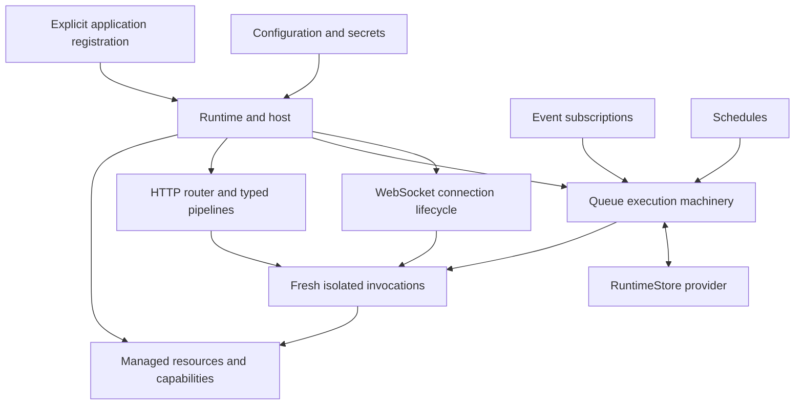

# Architecture and implementation

**Source precedence:** the selected requirements in syntax reference revision 0.3,
[section 21.2](features/DSharp_Syntax_Reference.md), and the handoff's section 4
supersede older conflicting examples here. In particular, declarations are public,
interfaces may supply method defaults, `T?` matches present values or null,
`Success(value)` constructs results, local builders cannot escape, and callable
workers differ from enqueue-only agents. No default-service selection is implied.
Remaining syntax/API proposals stay provisional. Only the literal-function subset
in [COMPILER_BOOTSTRAP.md](COMPILER_BOOTSTRAP.md) is currently executable.

This document explains [Feature specification v0.2](design/FEATURES.md).
Runtime components below are planned. The minimal compiler bootstrap is implemented;
see [its exact scope](COMPILER_BOOTSTRAP.md).
Package names and provisional choices are not compatibility guarantees.
See [Type system and syntax](LANGUAGE.md) for language contracts and the
[README](../README.md) for motivation.

## Components and their interactions

The language supplies immutable data, contracts, and typed composition. The
runtime supplies invocation lifecycles, explicit dependency composition,
supervision, startup, and shutdown. Optional packages supply transports and
durable work. Application code explicitly connects these parts.

| Proposed package area | Responsibility |
| --- | --- |
| Runtime and Hosting | Execution, supervision, composition, registration, startup, shutdown. |
| HTTP and WebSockets | Optional transports, typed pipelines, connection lifecycle. |
| Authentication and Authorization | Identity providers, checks, typed context; exact package split open. |
| Messaging and Queues | Typed payloads and durable execution policies. |
| Events and Scheduling | Subscriptions and cron using queue execution. |
| Storage | RuntimeStore contract and SQLite, PostgreSQL, MySQL, or third-party adapters. |
| Configuration and Secrets | Validated settings and asynchronous secret providers. |

These are composable first-party NuGet package areas, not an implemented package
catalog. Workers need not host HTTP; HTTP applications need not use queues.

## Composition and lifecycle

Each handler declares its trigger beside its typed implementation. The application
explicitly registers enabled handlers, supplies dependencies, and selects stores.
Declarations are inspectable before execution: registration creates an invocation
recipe, not shared mutable handler state or execution of business logic.
Explicit registration groups are allowed; global service location and automatic
handler discovery are not. Distributed location tracking must not introduce
feature discovery.

| Trigger | Declaration describes |
| --- | --- |
| HTTP | Method, route, middleware pipeline, handler contract. |
| Queue | Stable queue identity, payload contract, execution defaults. |
| Event | Event contract, stable subscription identity, delivery defaults. |
| Schedule | Stable schedule identity, cron expression, timezone, missed-run policy. |

Handler defaults define retry, ordering, and concurrency where applicable.
Application overrides may constrain budgets but cannot violate correctness
requirements such as sequential processing. Central HTTP registration does not
serialize requests through one actor: the router dispatches concurrently under
execution policies. Structured declarations should support route, queue,
schedule, and subscription inventories without maintaining separate YAML.

Startup validates registrations, resolves settings and secrets, initializes
independent resources concurrently, and starts ready components. Required eager
resources must be ready before dependent consumers accept work. Lazy resources
share one initialization attempt among concurrent callers and permit controlled
retry after failure. Failed startup and shutdown release resources in dependency
order.

Configuration becomes validated immutable data. Proposed precedence is defaults,
base JSON, environment-specific JSON, then environment variables. Secrets resolve
asynchronously using an independent bootstrap credential or host identity and
are redacted in diagnostics. Rotation requires explicit resource refresh or
replacement; immutable settings do not rotate a live client by themselves.
Configuration-source APIs and custom startup hooks remain open.

## Invocation, ownership, and failure

A trigger normally creates a fresh isolated invocation under its execution policy.
Concurrent triggers may create concurrent instances. Each owns private state and
communicates through typed messages and service references. Awaiting another
service result does not occupy a worker thread.

Ordinary handler failures are contained; callers receive failure or timeout.
Dependencies do not automatically propagate crashes or establish supervision.
Supervision governs restart and recovery. Retrying an operation is separate from
restarting an instance, and neither undoes external side effects.

Persistent actors and restart-state restoration remain unresolved. Sequential
queues do not preserve invocation memory. A proposed persistent-actor default
runs one handler through completion, including awaits; call cycles would need
bounded waits and careful design. Fatal CLR or native failures may terminate the
OS process. BEAM-style per-actor GC and execution preemption are not promised.

| Dependency | Ownership rule |
| --- | --- |
| Immutable value | Shareable without mutation, including nested collections. |
| Service reference | Grants contract access without exposing private state. |
| Resource capability | Safe operations over runtime-managed infrastructure. |
| Connection or stream | Exclusively owned in a bounded operation scope. |

Database pools are shared infrastructure. Operations borrow and return
connections; a transaction owns one connection for its scope. Transaction handles
cannot escape or be sent to another actor. Filesystem capabilities can restrict
directories and operations. Simple operations manage handles; streams close on
completion or failure. File handles normally need no pooling.

Private memory does not prevent races in external files or data. Use an owning
actor or storage coordination. Closing a failed write does not undo partial
output; atomic replacement is a separate operation.

## HTTP pipelines

A registered route connects compatible typed steps to an isolated handler.
Typical steps authenticate, check permission, decode a body, and invoke business
logic. Resource-specific authorization may follow decoding an identifier and
loading its resource.

Steps explicitly preserve or transform context. Decoding must retain identity
or permission information needed downstream. Typed failures can stop execution;
the HTTP boundary maps authentication, authorization, decoding, and application
failures to responses. Exact response mappings remain unspecified.

Middleware must also wrap downstream execution for tracing, logging, and scoped
resources, including cleanup after success, failure, or cancellation. Value
transformations alone are insufficient. No untyped request-property bag, casts,
or global request context is required to connect steps.

Types verify required context is supplied. Authentication still verifies
credentials at runtime; authorization still checks permissions at runtime.
Authorization evidence needs controlled construction and an operation/resource
scope. Identity types, evidence representation, and provider APIs remain open.

## Durable work

Request/reply, durable submission, and event publication are distinct operations.
Durable acceptance records work, not its successful execution or external effects.
Each attempt normally runs a typed immutable payload in a fresh invocation.

The conceptual execution path is:

1. Atomically enqueue with stable identity and eligibility time.
2. Claim eligible work under ordering and concurrency policies.
3. Execute outside the claim transaction; renew ownership as needed.
4. Complete, reject, reschedule, or retain exhausted work as appropriate.
5. Recover expired claims. Attempt tokens reject stale acknowledgements after
   ownership changes, but cannot prevent every duplicate external effect.

Exact state names and APIs are not defined. Delivery is at least once. Stable
message identities and deduplication help; handlers remain responsible for
idempotent effects. Retry policies specify eligible failures, attempt limits,
backoff, and jitter. Rescheduling releases a slot rather than leaving an instance
asleep. Exhausted work remains inspectable and manually retryable. Operational
controls include inspection, pause, resume, cancellation, and retry. Cancellation
can be cooperative and never implies rollback of completed effects.

| Policy | Meaning |
| --- | --- |
| Concurrent | Eligible messages execute up to a limit. |
| Sequential | One message completes before the next begins for a queue or key. |
| Partitioned | Each key is sequential while other keys progress. |
| Delayed | Work becomes eligible at or after a specified time. |
| Bounded | Pending capacity and active concurrency are limited; overload waits or rejects explicitly. |

A delayed retry at the head blocks its key until completion, explicit skipping,
or abandonment. FIFO dispatch alone does not preserve completion order.
Concurrency scope is explicit: host, deployment, or key. Deployment-wide limits
require a capable shared store. Unsupported guarantees must be rejected, not
silently weakened.

### Events and schedules

An event has zero or more subscriptions, each receiving an independent queued
delivery with its own outcome. Workers in one subscription compete for its work;
they are not separate subscribers. Subscription declarations identify triggers
and handlers; the runtime manages backing queues without requiring a separate
queue reference or message mapping. Optional filters and mappings should be pure
and deterministic. Durable fan-out must recover without omitting subscribers.

Cron is another queue trigger. Schedules persist timezone and delivery progress.
Missed runs explicitly skip, run once, or catch up. Delayed jobs and cron share
execution machinery. Queue and scheduled handlers establish their own identity
and permission semantics; a saved authenticated HTTP context is not an implicit
permission policy for later work.

## Runtime persistence

RuntimeStore provides atomic runtime operations rather than generic get/save
methods. It is logically separate from business data.

| Proposed provider | Deployment model |
| --- | --- |
| SQLite default | One runtime file per application on persistent local storage; single host. |
| PostgreSQL | Application schema supporting shared coordination across hosts. |
| MySQL | Application database with equivalent required semantics. |
| Third party | Implements the contract and declares capabilities. |

One SQLite file keeps related runtime changes transactional. Separate files are
an advanced option for independent workloads. Naming does not replace access
permissions.

Atomic operations cover enqueue, claim, ownership renewal, completion,
rescheduling, and retained failures. Schedule advancement and occurrence creation
must be atomic together, as must completion and follow-up enqueueing in the same
store. Claims need expiry and attempt tokens. Stable queue, subscription, and
message-contract identities survive deployments; stored payloads need versioning
and migrations. Store migration, retention, and recovery belong to the provider
and runtime lifecycle.

These transactions do not cover a separate business database. Reliable
publication alongside business changes requires an explicit outbox or equivalent
coordination.

## WebSockets

The optional package manages long-lived connections and typed messages. Message
handlers can use isolated invocations. Outbound writes need bounded buffering
and defined ordering. Durable notifications cannot preserve live sockets across
restart; reconnection and missed-message recovery require an explicit protocol.

## Compiler and .NET implementation

.NET is the target platform, including CLR garbage collection. The conceptual
path is source code, type/composition checks, executable .NET output, and runtime
hosting. The approved bootstrap uses C# on .NET 10, a hand-written lexer/parser,
a syntax tree, binding/type checks, a small typed representation, and deterministic
readable C# emission built through the pinned .NET SDK. No runtime framework
(including Akka.NET) is selected or required. The implemented subset and exact
pins are recorded in [COMPILER_BOOTSTRAP.md](COMPILER_BOOTSTRAP.md).

Generated output uses normal managed .NET execution. Native AOT is deferred:
future imported packages may require runtime features incompatible with AOT.
Future package interop still requires the safety contracts described below.

Compatible C# and F# NuGet libraries require compiler and build integration.
Interop must address CLR constructors, methods, properties, interfaces, generics,
delegates, tasks, cancellation, and deterministic disposal. Foreign nulls and
exceptions need mapping into the eventual optional/error models. Mutable foreign
objects need wrapping or conversion at isolation boundaries. F# options, unions,
functions, and asynchronous computations need explicit support. Source generators,
native dependencies, framework compatibility, and future trimming/AOT impose
additional constraints. The safe boundary and escape hatches remain unresolved;
targeting .NET is not a blanket package compatibility guarantee.

| Validation phase | Responsibility |
| --- | --- |
| Compile time | Statically known pipeline connections, signatures, referenced contracts, exhaustive matching. |
| Startup | Duplicate routes/identities, missing dependencies, incompatible registrations, unsupported store policies, runtime-dependent settings. |
| Execution | Input decoding, credential and permission checks, external failures, timeouts, ownership recovery. |

Compiler-generated versus library-defined registration and metadata limits are
open decisions. Deep immutability and resource isolation need enforcement at
language boundaries, especially interop; exact enforcement machinery is open.

## Proposed implementation sequence

1. Typed immutable messages, explicit registration, and SQLite-backed enqueue,
   execution, retries, and crash recovery. Define minimum safe .NET interop early.
2. Cron and event fan-out using the same durable execution machinery.
3. HTTP handlers and typed middleware, including authentication.
4. WebSockets and additional RuntimeStore providers.

Use a controllable clock and provider conformance tests for retry recovery, stale
claims, and supported atomic operations. These tests are planned, not present or
executed in this repository.

## Remaining design work

Language decisions are listed in [LANGUAGE.md](LANGUAGE.md). Runtime decisions
include persistent actor lifetimes and restoration, distributed ordering, lease
recovery, cancellation, cron catch-up, rotation protocols, serialization evolution,
registration mechanics, and configuration hooks. Outbound HTTP resilience,
observability, business-data APIs and outbox ergonomics, general streaming,
operations, and testing APIs are follow-up areas. gRPC is explicitly deferred.
